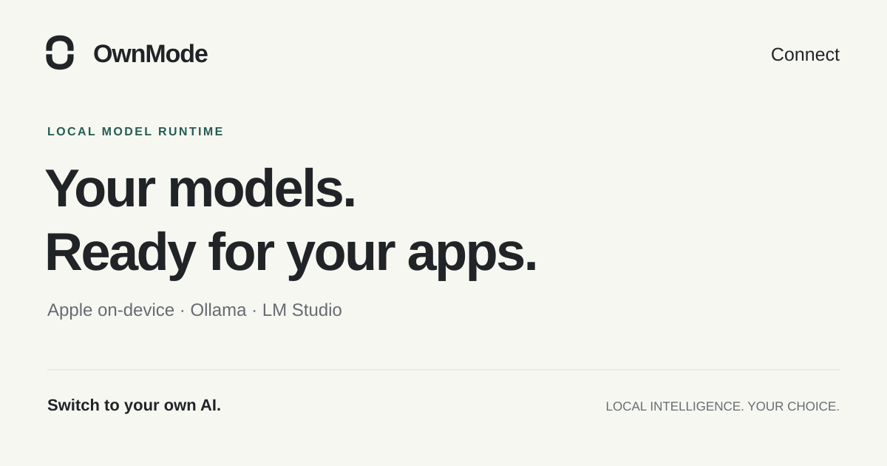

<p align="center"></p>

# Ownference
### Your models. Your machine. Only the apps you approve.

Give websites and browser tools a permissioned connection to **Apple on-device models, Ollama or LM Studio**—without a cloud inference account.

<p><a href="https://github.com/edwinjosechittilappilly/ownference/releases">Download releases</a> · <a href="#quick-start">Quick start</a> · <a href="#mac-menu-bar-and-startup">Mac app & startup</a> · <a href="#connect-a-website">Browser relay</a> · <a href="docs/architecture.md">Architecture</a></p>



**Apache-2.0 · Node 24+ · Local inference · Private preview**

## What it unlocks

- A writing assistant that uses the model already on your computer.
- A cooperating web app that lets each visitor bring their own compute.
- One local interface for switching between installed model providers.
- A visible Mac menu-bar controller and opt-in startup, instead of an unexplained background process.

Inference uses your CPU/GPU, memory and battery. There is no cloud fallback—not a promise of free or unlimited compute.

## Quick start

Install Node 24+, [GitHub CLI](https://cli.github.com/) and [Ollama](https://ollama.com/), or run an existing local provider. These repositories/releases are currently **private**; your GitHub account needs access.

```sh
gh release download v0.2.0 \
  --repo edwinjosechittilappilly/ownference \
  --pattern ownference-bridge-0.2.0.tgz

# Try the release without a global install:
npx --yes --package "$PWD/ownference-bridge-0.2.0.tgz" ownference doctor

# Or install the CLI in a user-writable npm prefix:
npm install -g ./ownference-bridge-0.2.0.tgz
```

With Ollama running, install a model once, then start the bridge:

```sh
ollama pull llama3.2:latest
ownference serve
```

In another terminal:

```sh
ownference grant --origin http://localhost:4173
```

Paste the token into [Ownference Web](https://github.com/edwinjosechittilappilly/ownference-web). Choose a model, paste text and generate. A grant is an exact **scheme + host + port**; `localhost` and `127.0.0.1` are different.

Tarballs are GitHub release artifacts, **not public npm registry packages**. `npx @ownference/bridge` is not an advertised installation path. Releases include SHA256SUMS for verifying downloaded artifacts.

## Connect a website

Choose one explicit transport:

| Transport | Who authorizes it | Credential visible to the page |
|---|---|---|
| Direct loopback SDK | User creates a grant for the exact website origin | An origin-scoped bearer token |
| Browser relay | User enables the current tab in Ownference Tabs; a native host is installed locally | No bridge token |

The relay routes **frontend → extension → native host → local bridge → model**. It does not intercept a website's server-side AI calls.

Install [Ownference Tabs](https://github.com/edwinjosechittilappilly/ownference-tabs), then use the extension ID shown by Chrome:

```sh
ownference native install --extension-id iacejanagmkfpcajmcnlbikgnmomdpba
ownference native status
```

The ID above belongs to the keyed unpacked release. If your installation has another ID, use that actual ID. Native installation copies code into durable private storage; it does not depend on an npx cache. Enable relay access in the extension **for the current tab**, then connect the cooperating frontend.

Remove native messaging with `ownference native uninstall`. Revoke an origin with `ownference revoke --origin http://localhost:4173`. Revocation is explicit and takes effect on subsequent requests.

## Mac menu bar and startup

The release also contains **Ownference-Bridge-MenuBar.zip**. Download and extract it, then open the contained app. It shows bridge reachability and provides start/stop controls; it only stops processes it started.

```sh
gh release download v0.2.0 --repo edwinjosechittilappilly/ownference \
  --pattern Ownference-Bridge-MenuBar.zip
ditto -x -k Ownference-Bridge-MenuBar.zip "$HOME/Applications"
open "$HOME/Applications/Ownference-Bridge-MenuBar.app"
```

Configure its absolute Node/CLI paths as described in [desktop integration](docs/native-startup.md). The app is ad-hoc signed, not Developer ID signed or notarized. Do not disable Gatekeeper to run it.

Startup is **off until requested**:

```sh
ownference startup install
ownference startup status
ownference startup uninstall
```

These commands manage your user LaunchAgent, not a system daemon. Installation uses a durable runtime copy and an absolute Node path; changing your Node installation can require reinstallation.

## Provider support

| Provider | Setup | Important limit |
|---|---|---|
| Ollama | Local server at `127.0.0.1:11434` and a downloaded generation model | Quality and capabilities depend on the selected model |
| LM Studio | Local server at `127.0.0.1:1234/v1` and a loaded model | Live LM Studio availability is checked separately |
| Apple on-device | macOS 26+, supported Apple Intelligence hardware, enabled/ready model and the Swift adapter | Context window, languages and Apple guardrails apply |

`ownference doctor` reports actual availability. Configure other **loopback-only** provider endpoints with `--ollama-url` / `--lmstudio-url` on `serve` or `doctor`. The bridge listens only at `127.0.0.1:3210`; `serve --port 3211` changes it.

For Apple from a source checkout, run `npm run build:apple` with a compatible Xcode command-line toolchain. Prefer the standalone [Ownference Mac](https://github.com/edwinjosechittilappilly/ownference-mac) app if you want Apple preset workflows **without Node**. Apple models do not work on every Mac.

## Small developer interface

- `GET /health`: reachability and runtime version.
- Authenticated `GET /v1/models`: provider-prefixed IDs and availability.
- Authenticated `POST /v1/generate`: `{model, task, text, instruction?}`.
- Tasks: `summarize`, `rewrite`, `extract`, `compare`, `draft`.
- NDJSON deltas, then exactly one completion or error; disconnect cancels upstream work.

Use the [Web SDK](https://github.com/edwinjosechittilappilly/ownference-web) instead of parsing streams yourself. Input/output bounds, deadlines and concurrency limits are enforced locally.

## Trust is a feature

Exact Host/Origin checks, hashed grants, no wildcard CORS, loopback-only providers and private configuration permissions protect the interface. Tokens are bearer credentials: any holder can use them outside a browser. Only approve sites you trust.

Prompts are not logged or persisted by the bridge. A site receiving generated output can still transmit it elsewhere. Prompt injection remains possible; generated text never authorizes file access, purchases, mail sending or shell execution. Apple acceptable-use requirements and individual model licenses still apply.

## Develop, verify, contribute

```sh
npm ci
npm run check
npm run smoke:ollama
npm run build:apple
npm run build:menubar
```

Checks include lint, secret scanning and coverage-gated behavior tests. See [testing](docs/testing.md), [verification evidence](docs/verification.md), [security](SECURITY.md) and [contributing](CONTRIBUTING.md). No self-awarded production/security score.

**The family:** [Bridge](https://github.com/edwinjosechittilappilly/ownference) · [Web SDK](https://github.com/edwinjosechittilappilly/ownference-web) · [Tabs + Relay](https://github.com/edwinjosechittilappilly/ownference-tabs) · [Native Mac](https://github.com/edwinjosechittilappilly/ownference-mac)

Licensed under [Apache-2.0](LICENSE). Ownference is a working brand, not trademark-cleared. Public visibility is a separate release decision; private previews cannot spread publicly.
